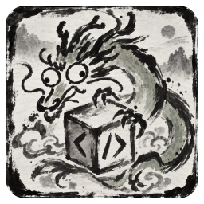

  

<h1 align="center">Cutex Desktop</h1>

  A desktop client for persistent coding agents on local and remote hosts.

  <a href="https://github.com/senxiu-official/cutex-desktop/releases/latest">Download</a> ·
  <a href="docs/install/AGENT-INSTALL.md">Install guide</a> ·
  <a href="docs/QUICKSTART.md">Quick start</a> ·
  <a href="CHANGELOG.md">Changelog</a> ·
  <a href="https://github.com/senxiu-official/cutex-desktop/issues">Issues</a>

<b>English</b> · <a href="README.zh-CN.md">简体中文</a>

  
  
  

## Overview

Cutex Desktop is the desktop app for [cutex](https://github.com/senxiu-official/cutex), a daemon that
runs coding agents on your own machines. Each agent is a persistent session on
[cute-codex](https://github.com/senxiu-official/cute-codex) (a fork of OpenAI Codex) or on Claude Code.
All state lives in cutex and the app is only a client, so agents keep working, and talking to each
other, while the app is closed.

## Features

**Agent collaboration**
- **Persistent agents** grouped into projects, each with its own name, avatar and history.
- **Delegations**: agents hand tasks to each other and wait for the results; the Delegations page
  shows who asked whom for what, and you can review, pause or stop them.
- **Questions and approvals** arrive in the conversation; host owners can add scoped, expiring
  auto-approval rules.
- **Queue, steer or interrupt** a turn; alarms wake an agent later; side chats, notes and bookmarks
  on any message; fork an agent or revert it to an earlier turn.

**Local and remote hosts**
- **Local and remote hosts**: add a machine over SSH (the app opens the tunnel and pairs by itself),
  switch between hosts or show all of them at once.
- **Files, diffs and terminals** go through the daemon, so a remote host works like the local one;
  remote files can be copied to this computer.
- **Shared hosts**: several people can use one host as separate users, each with their own devices.

**Workspace**
- **Shelf and tray layout**: every conversation keeps its own Shelf of pages and tabs; open
  conversations side by side, drag panes to split or merge them, and pin items to the tray.
- **In-app browser** you can lend to an agent, plus artifacts, project services and home widgets.
- **Avatar themes** with character portraits, emoji or initials.

**Models and usage**
- **Profiles** for ChatGPT, Claude and OpenAI-compatible APIs; each agent uses one, and you can
  switch at any time. Profiles can be imported from CC Switch.
- **Quota and cost**: plan quota where the provider reports it, and token usage and cost across all
  hosts, merged by Profile.

**Privacy and isolation**
- **No account and no telemetry.** API keys and tokens stay in the daemon and the app's main process.
- **Sandboxed plugins**: third-party code runs only in isolated frames with no network, and plugins
  are off by default. See [SECURITY.md](SECURITY.md).

## Download

Current public release: **v0.2.2 — Beautiful World**. The 0.2 series uses the name Beautiful World. Downloads are on the
[latest release page](https://github.com/senxiu-official/cutex-desktop/releases/latest).

| Platform | Package | What runs there |
|---|---|---|
| Windows 10 / 11 x64 | `cutex-desktop-<version>-windows-x64.zip` | cutex, agents and the desktop |
| Linux x64 | `cutex-desktop-<version>-linux-x64.tar.gz` | cutex, agents and the desktop |
| macOS (Apple silicon / Intel) | `cutex-desktop-<version>-macos-arm64.zip` / `-macos-x64.zip` | the desktop only, connected to a Linux or Windows machine of yours that runs cutex |

The desktop needs cutex and its agent runtime on at least one machine; the
[install guide](docs/install/AGENT-INSTALL.md) installs all three from signed release binaries. Every
file is signed with minisign (see the guide, B.1, to verify). The apps are not code-signed with a paid
certificate, so Windows SmartScreen and macOS Gatekeeper warn on the first start (guide, B.6).

## Quick start

1. **Install cutex and the desktop.** Follow [docs/install/AGENT-INSTALL.md](docs/install/AGENT-INSTALL.md)
   (signed binaries; no compiler required). The guide includes commands suitable for manual or
   agent-assisted installation.
2. **Open the app.** It finds the local cutex by itself. On macOS, or for another machine, use
   **Add SSH host…** in the host menu at the top left.
3. **Add a Profile** in Settings → Profiles (a ChatGPT or Claude login, or an API key).
4. **Create an agent**: click **New agent** (the + person icon at the left of the title bar), pick a
   folder and a Profile, and start talking.

The app updates itself: when a new release is out, an **Update** button appears next to Settings.
Hosts are updated separately, in Settings → Host backend updates. A short tour is in
[docs/QUICKSTART.md](docs/QUICKSTART.md).

## Documentation

- [Install, update and troubleshooting](docs/install/AGENT-INSTALL.md)
- [Quick start](docs/QUICKSTART.md) (Chinese, with an English summary)
- [Known issues](docs/KNOWN-ISSUES.md) (also in the app: Settings → About)
- [Changelog](CHANGELOG.md)
- [Optional modules for Claude Science and NCI remote jobs](docs/install/ANU.md)
- [Architecture and product decisions](docs/DESIGN.md)
- [Module contract](docs/desktop-modules.md), [writing a module](docs/module-dev-guide.md) and
  [plugin examples](examples/README.md)

## Platform support

Windows and Linux support both the desktop and cutex host services. macOS supports the desktop
client connected to a Windows or Linux host. Remote connections use SSH or a trusted private
network. Platform and component limitations are listed in [known issues](docs/KNOWN-ISSUES.md).

## Contributing and support

Bug reports and translation fixes are welcome as
[GitHub issues](https://github.com/senxiu-official/cutex-desktop/issues). To build from source or
change the code, see [CONTRIBUTING.md](CONTRIBUTING.md). Report security problems privately as described in [SECURITY.md](SECURITY.md).

## Related projects

- [cutex](https://github.com/senxiu-official/cutex): the daemon that runs the agents and keeps all
  their state.
- [cute-codex](https://github.com/senxiu-official/cute-codex): the agent runtime, a fork of OpenAI
  Codex with cross-agent input.

## License and acknowledgements

Apache License 2.0: see [LICENSE](LICENSE) and [NOTICE](NOTICE). Third-party material and its licenses
are listed in NOTICE and [LICENSES/](LICENSES).

Parts of the user interface are adapted from [ZCode](https://github.com/zai-org/ZCode) (Apache-2.0,
Copyright 2026 Z.AI Co., Ltd); the adapted files are listed in [NOTICE](NOTICE).

Built with Codex, Claude, DeepSeek, GLM and Kimi. Product names are trademarks of their owners;
naming them implies no affiliation or endorsement.
