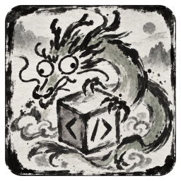

<!-- 与 README.md 保持同步：标题相同、顺序相同，两份在同一个提交里修改。 -->

  

<h1 align="center">Cutex 桌面端</h1>

  长时间运行的编程智能体在桌面上的家：Codex 和 Claude 智能体在你自己的电脑上持续工作，并且互相协作。

  <a href="https://github.com/senxiu-official/cutex-desktop/releases/latest">下载</a> ·
  <a href="docs/install/AGENT-INSTALL.md">安装指南</a> ·
  <a href="docs/QUICKSTART.md">快速上手</a> ·
  <a href="CHANGELOG.md">更新日志</a> ·
  <a href="https://github.com/senxiu-official/cutex-desktop/issues">问题反馈</a>

<a href="README.md">English</a> · <b>简体中文</b>

  
  
  

<!-- hero screenshot: docs/images/hero-light.png / hero-dark.png (pending) -->

## Cutex 桌面端是什么

Cutex 桌面端是 [cutex](https://github.com/senxiu-official/cutex) 的桌面应用。cutex 是在你自己的电脑上运行编程智能体的
后台服务。每个智能体都是一个持久的会话，运行在 [cute-codex](https://github.com/senxiu-official/cute-codex)（OpenAI Codex
的分支）或 Claude Code 上。所有状态都在 cutex 里，桌面端只是客户端，所以关掉应用后，智能体照样工作，也照样互相沟通。

## 亮点

**互相协作的智能体**
- **持久的智能体**按项目分组，各有自己的名字、头像和历史。
- **委托**：智能体之间互相分派任务并等待结果；「委托」页显示谁让谁做了什么，你可以审核、暂停或停止。
- **提问和审批**直接出现在对话里；主机主人可以设置有范围、会过期的自动审批规则。
- 每一轮都可以**排队、引导或打断**；闹钟稍后叫醒智能体；任何消息都能开侧聊、加批注和书签；可以分叉智能体，
  或回退到之前的某一轮。

**你的电脑**
- **本机和远程主机**：通过 SSH 添加另一台电脑（桌面端自动建隧道、自动配对），可以切换主机，也可以同时显示所有主机。
- **文件、改动对比和终端**都经过后台服务，远程主机和本机用法一样；远程文件可以复制到这台电脑上。
- **共用主机**：多人可以作为不同用户共用一台主机，各自管理自己的设备。

**工作区**
- **Shelf 和托盘布局**：每个对话都有自己的 Shelf（页面和标签）；对话可以并排打开，拖动窗格来拆分或合并，
  常用项目可以固定到托盘。
- 可以借给智能体用的**内置浏览器**，以及成果库、项目服务和主页小组件。
- **头像主题**：角色立绘、emoji 或首字母。

**模型和用量**
- **Profile** 支持 ChatGPT、Claude 和 OpenAI 兼容接口；每个智能体用一个，随时可以换。可以从 CC Switch 导入 Profile。
- **额度和费用**：服务商提供的套餐额度会直接显示；所有主机的 token 用量和费用按 Profile 合并统计。

**隐私优先**
- **不用账号，不收集任何数据。** API 密钥和令牌只在后台服务和应用主进程里。
- **插件在沙盒里运行**：第三方代码只在隔离的框架里运行，不能联网，插件默认关闭。见 [SECURITY.md](SECURITY.md)。

## 下载

当前公开版本：**v0.2.0**。下载见[最新发布页](https://github.com/senxiu-official/cutex-desktop/releases/latest)。

| 平台 | 安装包 | 运行什么 |
|---|---|---|
| Windows 10 / 11 x64 | `cutex-desktop-<版本>-windows-x64.zip` | cutex、智能体和桌面端 |
| Linux x64 | `cutex-desktop-<版本>-linux-x64.tar.gz` | cutex、智能体和桌面端 |
| macOS（Apple 芯片 / Intel） | `cutex-desktop-<版本>-macos-arm64.zip` / `-macos-x64.zip` | 只有桌面端，连接你自己的一台运行 cutex 的 Linux 或 Windows 电脑 |

桌面端需要至少一台电脑上装有 cutex 和它的智能体运行时；[安装指南](docs/install/AGENT-INSTALL.md)（英文）会用签名的
发布二进制把三者都装好。每个文件都有 minisign 签名（验证方法见指南 B.1）。应用没有用付费证书做代码签名，所以第一次
启动时 Windows SmartScreen 和 macOS Gatekeeper 会提示（见指南 B.6）。

## 快速开始

1. **安装 cutex 和桌面端。** 按 [docs/install/AGENT-INSTALL.md](docs/install/AGENT-INSTALL.md) 操作（约 15 分钟，不用编译）。
   这份指南写得让 Claude Code、Codex 这样的编程助手也能从头照做：最省事的办法是直接交给你的编程助手。
2. **打开应用。** 它会自己找到本机的 cutex。在 macOS 上，或者要连另一台电脑，用左上角主机菜单里的
   **「添加 SSH 主机…」**。
3. **添加 Profile**：设置 → Profile（ChatGPT 或 Claude 账号登录，或者 API key）。
4. **创建智能体**：点**「新建智能体」**（顶栏左边的「＋人像」图标），选一个文件夹和 Profile，就可以开始对话了。

应用会自动更新：有新版本时，「设置」旁边会出现**「更新」**按钮。主机要单独更新，在「设置 → 主机后端更新」里。
更详细的介绍见 [docs/QUICKSTART.md](docs/QUICKSTART.md)。

## 文档

- [安装、更新和排错](docs/install/AGENT-INSTALL.md)（英文）
- [快速上手](docs/QUICKSTART.md)
- [已知问题](docs/KNOWN-ISSUES.md)（应用里：设置 → 关于）
- [更新日志](CHANGELOG.md)
- [Claude Science 和 NCI 远程作业的可选模块](docs/install/ANU.md)
- [架构和产品决策](docs/DESIGN.md)
- [模块接口](docs/desktop-modules.md)、[如何写一个模块](docs/module-dev-guide.md)和[插件示例](examples/README.md)

## 项目状态

Cutex 桌面端还很年轻：作者每天都在用，但其他用户还不多，难免有粗糙的地方，尤其是 macOS 和不常用的模块。
远程访问默认在你自己的网络里（SSH 或你信任的私有 tailnet）。报告问题前请先看[已知问题](docs/KNOWN-ISSUES.md)。

## 参与和支持

欢迎在 [GitHub issue](https://github.com/senxiu-official/cutex-desktop/issues) 里报 bug 或修正翻译。从源码构建或修改代码，
见 [CONTRIBUTING.md](CONTRIBUTING.md)。安全问题请按 [SECURITY.md](SECURITY.md) 私下报告。觉得有用的话，欢迎在 GitHub 上
点个 Star，方便更多人找到它。

## 相关项目

- [cutex](https://github.com/senxiu-official/cutex)：运行智能体、保存全部状态的后台服务。
- [cute-codex](https://github.com/senxiu-official/cute-codex)：智能体运行时，OpenAI Codex 的分支，支持智能体之间的消息输入。

## 许可和致谢

Apache License 2.0：见 [LICENSE](LICENSE) 和 [NOTICE](NOTICE)。第三方内容及其许可证列在 NOTICE 和 [LICENSES/](LICENSES) 里。

部分界面改编自 [ZCode](https://github.com/zai-org/ZCode)（Apache-2.0，Copyright 2026 Z.AI Co., Ltd），
改编的文件列在 [NOTICE](NOTICE) 里。

由 Codex、Claude、DeepSeek、GLM 和 Kimi 参与构建。产品名称是各自所有者的商标，提及不代表有任何关联或背书。
