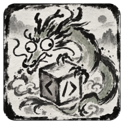

<p align="center">
  
</p>

<h1 align="center">Cutex 桌面端</h1>

<p align="center"><a href="README.md">English</a> · <b>简体中文</b></p>

**0.1.0「First Take」**：第一个公开版本。更新内容见 [CHANGELOG.md](CHANGELOG.md)。

Cutex 桌面端是 [cutex](https://github.com/senxiu-official/cutex) 的桌面应用。cutex 是在你自己的电脑上运行编程智能体的
后台服务，智能体运行在 [cute-codex](https://github.com/senxiu-official/cute-codex)（OpenAI Codex 的分支）或 Claude Code 上。
所有状态都在 cutex 里，桌面端只是客户端，关掉应用智能体也照常工作。

支持 Windows 和 Linux（x64）。macOS 上只有桌面端，连接你自己的一台运行 cutex 的电脑。

## 功能

**智能体协作**
- 多个智能体同时工作，按项目分组。
- 智能体之间互相委托任务、等待结果；「委托」页面显示谁让谁做了什么。
- 智能体可以向你提问，你在对话里回答。
- 每一轮都可以排队、引导或打断。闹钟可以稍后叫醒智能体，需要你时会有通知。
- 任何一条消息都可以开侧聊、加批注、加书签。

**主机和用户**
- 通过 SSH 添加另一台电脑：桌面端自动建隧道、自动配对。可以切换主机，也可以同时显示所有主机。
- 文件、改动对比、终端都经过后台服务，远程主机和本机用法一样。
- 多人可以作为不同用户共用一台主机，各自管理自己的设备。

**模型和用量**
- ChatGPT、Claude 和 OpenAI 兼容接口都作为 Profile 使用。每个智能体用一个，随时可以换。
- 服务商提供的额度和套餐信息会直接显示。
- 所有主机的用量和费用，同名 Profile 合并显示。单独使用的 Claude Code、Codex、ZCode 的用量也可以加进来。

**对话周边**
- 文件、改动对比、终端、成果库、本地服务，以及可以借给智能体用的内置浏览器。
- 分叉智能体，或回退到之前的某一轮。
- 每个模块都可以关掉。

**自己部署**
- 不用账号，不收集数据。API 密钥和令牌只在后台服务和应用主进程里。
- Apache-2.0。

## 安装

目前没有预编译的安装包：cutex、cute-codex 和桌面端都在你自己的电脑上从源码构建。安装指南写了每一步，人照着做或者
交给编程助手（Claude Code、Codex 等）执行都可以。最省事的方式是直接把它交给你的编程助手：

**[docs/install/AGENT-INSTALL.md](docs/install/AGENT-INSTALL.md)**（英文）

| 平台 | 运行什么 |
|---|---|
| Linux x64 | cutex + 智能体 + 桌面端 |
| Windows 10 / 11 x64 | cutex + 智能体 + 桌面端 |
| macOS | 只有桌面端，通过 SSH 连接你自己的一台运行 cutex 的 Linux / Windows 电脑 |

装好指南里的前置环境后，桌面端只要三条命令（下面是 Linux；Windows 和 macOS 的命令在指南里）：

```sh
git clone --branch release https://github.com/senxiu-official/cutex-desktop.git ~/Applications/cutex-desktop/src
~/Applications/cutex-desktop/src/scripts/install-portable.sh --channel release
~/Applications/cutex-desktop/current/cutex
```

桌面端会自己找到本机的 cutex。先在 设置 → Profile 添加模型账号，再点「新建智能体」。安装会跟随 `release` 分支自动更新：
有新版本时，侧栏会出现「更新」按钮。

## 文档

- [docs/QUICKSTART.md](docs/QUICKSTART.md)：桌面端快速上手
- [docs/install/AGENT-INSTALL.md](docs/install/AGENT-INSTALL.md)：安装、更新、排错（英文）
- [docs/install/ANU.md](docs/install/ANU.md)：ANU 用户的可选模块（Claude Science、NCI），其他人用不到
- [docs/DESIGN.md](docs/DESIGN.md)：架构和产品决策
- [docs/desktop-modules.md](docs/desktop-modules.md)、[docs/module-dev-guide.md](docs/module-dev-guide.md)：
  模块接口，以及如何写一个模块

## 现状

这是第一版。作者每天都在用，但其他用户还不多，难免有粗糙的地方，尤其是 macOS 和不常用的模块。

- **插件默认关闭。** 第三方代码只在沙盒框架里运行，不能联网。
- **远程访问默认在你自己的网络里。** 机器之间通过 SSH 或你信任的私有 tailnet 连接。用户身份是为了方便和熟人共用主机，
  不是防陌生人的安全边界。

欢迎在 GitHub issue 里报 bug 或修正翻译。

## 从源码构建（开发）

需要 Node.js 24 和 pnpm（通过 corepack）。

```sh
corepack enable
pnpm install --frozen-lockfile
pnpm typecheck
pnpm test
pnpm dev            # 用 Electron 开发模式连接本机 cutex
```

- `node scripts/package-portable.mjs <目标目录>`：打一个便携包。
- `scripts/install-portable.sh`（Linux / macOS）和 `scripts/install-portable.ps1`（Windows）：构建并安装到
  可自动更新的目录结构（见安装指南）。
- `pnpm --filter @cutex-desktop/app preview:web`：在普通浏览器里用模拟数据运行界面，不需要 Electron 和 cutex。

## 发布方式

公开仓库是发布快照：每个版本是 `release` 分支上的一个提交，这个分支也是各安装的更新通道。
`EXPORT-MANIFEST.json` 列出快照里每个文件和它的 SHA-256。

## 致谢

由 Codex、Claude、DeepSeek、GLM 和 Kimi 参与构建。产品名称是各自所有者的商标，提及不代表有任何关联或背书。

部分界面改编自 [ZCode](https://github.com/zai-org/ZCode)（Apache-2.0，Copyright 2026 Z.AI Co., Ltd），
改编的文件列在 [NOTICE](NOTICE) 里。

## 许可证

Apache License 2.0：见 [LICENSE](LICENSE) 和 [NOTICE](NOTICE)。第三方内容及其许可证列在 NOTICE 和 LICENSES/ 里。
