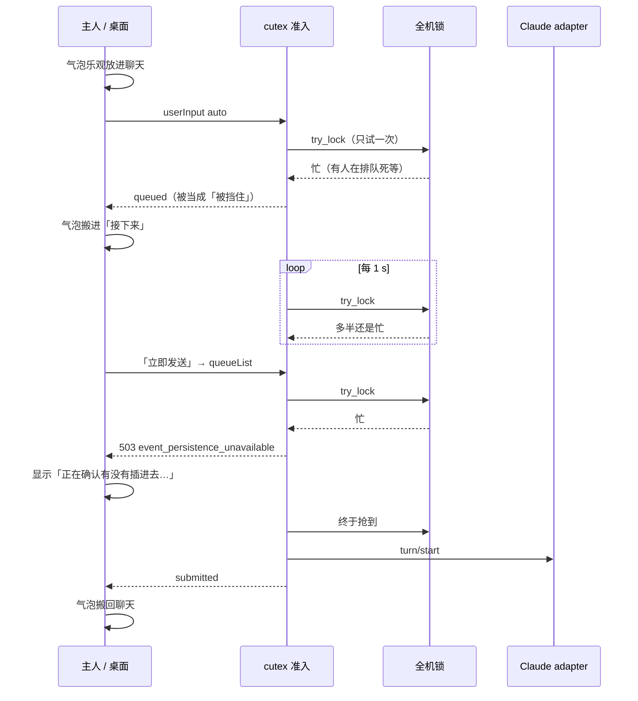

# 050 主人的消息怎么送到智能体（发送 / 排队 / 插话 / 中断）

> 以后这一块出问题，先读这份；改了设计就更新第 2、4、5、9 节。

状态：**已定，实现中**。桌面「马上能发」小包先做；cutex 部分进 r271，Claude 运行时部分进 claude-r34（新编号，不复用 r33）；存储和锁协议的大改造进 r272（归 Alice 的浪费写法计划）。

来源：主人 10-30 / 10-31 报告（EVA，cutex r270，Claude 智能体 deputy-Aria、Alice）：
1. 回复已经结束，发出的消息却进了「接下来」，显示「正在请求插话…」，又慢又在聊天和「接下来」之间来回跳；
2. 系统把智能体当成在忙，界面上却没有「工作中」那一行；
3. 回合中第一次插话显示「运行时拒绝插话」，第二次才插进去；
4. 「中断并发送」之后，每次都弹「已经中断，请继续发送」一类的提示，有没有委托都弹。

相关文档：
- 四份独立审查：sol `cutex:artifact/af-8aa48382196d417e8986ef957c2de2be@1` · opus `cutex:artifact/af-ce0d6d097fc8424fbec00cad5e50fafd@2`（最完整；§7 讲谁在占锁）· kimi `cutex:artifact/af-fb98c81a765242c2802280d2381d5a6c@1` · Pipit `cutex:artifact/af-62ef7d301ca84d49bb44bf5c95bea4d7@1`
- 合并结论与方案（主人 10-31 批准）：`cutex:artifact/af-f2dd6964816e4455a0bbaa8eb1fb3acb@1`（`.claude/reports/send-insert-plan-20261031.md`）
- Alice 的浪费写法修复计划（锁、存储那一半）：`cutex:artifact/af-5afa38879fc0487484c7703313dd4330@1`，审查 A `af-b967b250d6574642b9466a5c8a9739f1@1`、B `af-d3fbb6f16f6a42309489f2d8f41781f9@1`
- 相关旧方案：[010](010-quota-continue-delegations.md)（额度用完后的闸门）、[005](005-claude-background-subagents.md)（后台子智能体与插话）

行号：cutex 以 `release/r270 4af79b6e` 为准；桌面行号抄自 main `924f7663`（写文档时 main 已到 e8bbc4a2，个别行号可能偏移）。代码动了要顺手更新。

---

## 1. 现在的工作方式（r270）

### 1.1 一条消息走过的路

1. **桌面决定怎么发**。输入框按下发送：智能体空闲 → `auto`（普通发送）；在回合里 → 插话（steer）或「排队」；「中断并发送」→ `interrupt`。气泡先乐观地放进聊天（`outbox.ts:129`、`store.ts:2690`），等 cutex 的事件再决定留在聊天还是挪进「接下来」。
2. **cutex 准入**。`route_submit`（`app_server_user_input.rs:651`）、`queue_on_idle` / `owner_may_start`（789）、`steer_owner_input`（235）、`send_recorded`（1051）、`ensure_native_input_open`（1224）在动手前都要先确认「现在能不能送进去」：有没有暂停、委托 lease、闸门。这一步要拿**全机共用的一把锁** `agent-management-mutation-v1.lock`，而且**只试一次**（`pause_admission.rs:22-36`，r266 df47f1c1 引入）。
3. **抢不到锁**（Deferred）时，r270 把它当成「智能体被挡住」：普通发送进队列，之后每 1 s 重试一次（8a282648）；插话返回 `steer_unavailable{reason:"admissionBusy"}`；读队列（`queue/list`）返回 503，文字却写成 `event_persistence_unavailable`（`server.rs:3559` → `user_input.rs:688` → `pause_admission.rs:24`）。
4. **谁在占锁**：会排队死等这把锁的操作（`lock_mutations()`）：新建 / 归档 / 启动智能体（`provider.rs:1066-1084`，整个过程都占着，包括等新运行时上线，实测 28–40 s）；要查权限的工具（`director_address/resolution.rs:72`、`routing_policy/integration.rs:631`：派活、留言、停委托、路由批准）；重启恢复。每次在锁里写委托数据都要复制、比对整份状态（`asks/store.rs:1733-1800`，0.3–0.9 s）。Windows 上锁一放开就交给排队者，「只试一次」的几乎抢不到。
5. **Claude 运行时**（adapter，`subscription.py`）：空闲时 `turn/start` 开新回合；回合中，插话要等**下一次工具调用之后**才塞进去（PostToolUse），所以长工具期间只能等。回合结束顺序（`subscription.py:1398-1496`）：SDK 返回 → 最后一段标成 final_answer → 确认插话 → SDK 流结束 → `refresh_context` → finish → `turn/completed`。文字可见到回合真正结束，通常不到 1 s，偶尔几秒。被中断或失败的回合会关上输入闸门，`turn/start` 被拒（-32009）后 cutex 用 `ensure_native_input_open` 重开（`app_server_user_input.rs:1158-1185`），这一步也要抢同一把锁。
6. **桌面显示**。「工作中」一行只看运行时回合（`TurnTail`）；「正在发送 / 忙」看的是另一套状态（`sendBusy`，包含待插话）。两者不一致。插话结果的原因映射在 `queueSteer.ts:31/48`，不认识的原因归成「运行时拒绝」。「接下来」里点「立即发送」会先调 `queueList`（又抢一次锁）。
7. **中断并发送**（`store.ts:3259-3350`）两条路：A（没有待插话）直接 `submit(text,"interrupt")`，cutex 先 `turn/interrupt` 再 `turn/start`（`app_server_user_input.rs:710-746`）；B（有待插话）先 `cutex/turn/stop`，会建一个「停止暂停」（`control.rs:350-360`），再把插话合并成一条发出。新消息成功开回合时，`owner_message(started)` 解除停止暂停（`control.rs:386-392`）；如果新消息撞锁被入队，就不会解除。闸门暂停见 `scheduler.rs:1381-1387`；桌面「已暂停」那一条见 `DelegationQueue.tsx:108-111`；被中断回合的系统通知见 `store.ts:2472`。

### 1.2 时序（r270，空闲时撞锁的那一种）



---

## 2. 不变式（以后每次改动都必须守住）

1. **主人的消息不会因为内部锁忙而改变去向**。想普通发送的不会变成排队或插话；锁忙只能让它「等一会儿」，并且看得见在等。
2. **「忙」只有一个来源**：cutex 给出的会话状态 `admission.state`（见第 5 节）。桌面的发送决定、「工作中」一行、「接下来」都只读它，不各自推算。
3. **每条主人消息在界面上只占一个稳定的位置**。提交后固定在聊天里一行，状态在这一行里变；不在聊天、发件箱、「接下来」之间搬来搬去。
4. **每个 cutex 原因码在桌面都有专门映射**，有对照测试。未知原因要报警并如实显示，**不许默认成「运行时拒绝」**。
5. **跑在 bridge worker 上的代码永远不阻塞等全机锁**（生命周期停运行时会 join bridge worker，`pause_admission.rs:22-23`、`bus_bridge.rs:581-590`；违反就死锁）。需要等锁的事交给不会被 join 的专用线程。
6. **真正执行前在锁内复核一次暂停**（`pause_admission.rs:36`）。锁外读到的状态只能用来决定「先怎么显示」，不能用来省掉复核。
7. **「锁忙」和「暂停 / 被挡住」是两件事**，原因码不同：锁忙可重试，暂停要等人或条件。
8. **主人自己发起的中断不留提示，也不弹系统通知**。只有中断真的留下了要处理的东西（被打断的委托回合、工具效果不确定、确实有被挡住的委托或留言）时才提示。
9. **不自动换一种方式重发**。超时就变成可见的失败，带「重试」，由主人决定。重试同一个 `clientUserMessageId`，保证不重复。
10. **桌面错误日志记原始 `code`、`details.reason` 和原生错误**（脱敏），不只记映射后的种类。

---

## 3. 已知故障与根因（历史，按时间补充，不删）

| 现象 | 根因 | 证据 | 之前的补丁和为什么没管住 |
|---|---|---|---|
| ① 空闲时发的消息进「接下来」，慢 0.8–35 s，来回跳 | 准入只试一次锁，抢不到被当成「被挡住」，消息入队；每 1 s 重试又总抢不过排队者 | opus §2：10-30 Aria 空闲时发的 21 条里 8 条入队，入队时刻和同会话 `admission_deferred` 日志对上；`app_server_user_input.rs:651/789` | **df47f1c1（r266）**：所有准入改成只试一次抢同一把锁，主人的消息没区别对待——源头。**8a282648**：抢不到 1 s 后再试，以为锁忙是偶然；有排队者时几乎永远抢不到，651 行「抢不到 = 暂停」没动 |
| ①′ 点「立即发送」后卡在「正在确认有没有插进去…」 | `queuePromote` 先调 `queueList`，也要抢锁，503 且文字写成 `event_persistence_unavailable` | Pipit / opus：9 次 503 原文都是 `admission_deferred: lifecycle authority fence busy` | **db69cc0a / 8c0a68dd**：修了回执和历史谁先到的收尾，没碰为什么会入队或 503 |
| ② 系统当它忙，却没有「工作中」 | 截图那几次智能体没在跑回合，只是消息卡在等锁；没有任何地方显示「为什么卡着」。「工作中」和 `sendBusy` 是两套条件 | opus §2、sol 逐张截图核对（当时线程 idle）。回合快照缺 startedAt、后台通知扣留等其他路径代码里存在，这次没观察到（推测） | 无专门补丁 |
| ③ 第一次插话「运行时拒绝」，第二次成功 | 插话撞锁，cutex 返回 `admissionBusy`，桌面原因表没有它，归成「运行时拒绝」 | sol：12:45:53.891 409 `admissionBusy`，无原生错误；12:45:56.553 成功；`queueSteer.ts:31/48` | **45237203**：只在 `runtimeNoSteer` 时自动重试——条件从没触发。**b6a7f597**：能力「未知」也去试，修的是走不到的路 |
| ④ 中断并发送后每次弹「已中断 / 请继续」 | 推测：停止暂停或闸门暂停没解除（新消息撞锁入队，不解除）；或主人自己的中断也发系统通知 | 见 1.1 第 7 条；需要主人截图定是哪一个 | 无 |
| 插话「已接受」但很慢 | Claude 只在下一次工具调用后塞插话，长工具期间只能等 | opus §2；Pipit：接受到进入上下文 9–43 s | 设计行为；r271/r34 要把阶段显示出来 |
| 留言回执卡在「等待回执」 | 另一个问题（回执结算），不在本方案 | — | **653a2b15**：和主人自己的消息无关 |

共同教训：每次都在看到现象的那一层打补丁，没读真实原因码；测试里的 cutex 从没在抢锁或多会话负载下跑过；cutex 与桌面的原因码没有对照测试。

---

## 4. 目标设计

### 4.1 桌面「马上能发」小包（r270 主机上也安全）
1. `admissionBusy` 和 503 `admission_deferred` 认成「主机正忙」，自动退避重试 3–5 次（0.3 s → 2 s）。这两种确定没发出去，重试安全；重试期间保持「正在发送」。
2. `queuePromote` 不再先调 `queueList`（`queue/steer` 自己校验版本）。
3. 错误日志记原始原因码。
4. 「工作中」一行：回合快照缺 startedAt 时照样显示（取自 Pipit 分支 2b823e9e 的 `TurnTail` 改动）。
5. 原因码对照测试。

效果：「运行时拒绝」「正在确认」两种误报消失；空闲时入队的延迟要等 r271。

### 4.2 cutex（r271）
1. **锁的记账**：`lock_mutations`、`try_with_authority`、`execute_with_lifecycle_locks` 记调用点、等待和持有时长，超 500 ms 记一条。和 Alice 计划第 0 步是同一份实现。
2. **Deferred ≠ 暂停**：主人路径（第 1.1 节列的五处）抢不到锁不再算 held。是否暂停读已提交快照判断；执行前锁内复核（不变式 6）。
3. **专用准入线程**：请求线程抢不到锁时不入队、不报错，把消息记成「发送中，原因：主机忙」（durable，同一个 `clientUserMessageId`），立即返回 `accepted{state:"sending", heldBy:"hostBusy"}`。每台主机一个专用线程（不是 bridge worker，生命周期不会 join 它）阻塞排队等锁，拿到后复核暂停 / lease / 回合，按原意图发出（空闲 start，回合中且允许插话 steer），发 `cutex/userInput/submitted`。锁顺序：**先全机锁、或者等锁时不持有会话车道**（10-31 已证实 r270 有「全机锁 → 会话车道」的路径，见第 7 节第 1 条；「会话车道 → 全机锁」会死锁）。等待上限（如 60 s），超时变成可见的「主机一直忙，没发出去」+ 重试。
4. **统一会话状态** `admission.state`，入队带 `queuedReason`（见第 5 节）。
5. **原因码如实**：Deferred 不再写成 `event_persistence_unavailable`，改成可重试的 `admission_busy`。
6. **`queue/list` 读已提交快照，不拿锁**。
7. **中断并发送是一次主人操作**：中断、开闸、发新消息在一起完成，成功后清掉本次产生的停止 / 闸门暂停；新消息在专用线程里等锁时仍算「主人已确认」。

### 4.3 Claude 运行时（claude-r34）
1. 先发 `turn/completed` 和 idle，再 `refresh_context`。
2. 回合收尾（`accepting=False`）时收到插话明确拒绝，原因 `turnFinishing`；cutex 把它排到下一回合，不回 `steered`。
3. 按 clientId 单调上报插话阶段：已登记 → offered（已送进工具间隙）→ contextPersisted。
4. 后台通知扣留回合期间发可见状态（如 `activeFlags:["heldByNotification"]`）。
现有会话保持固定版本，换不换由主人决定。

### 4.4 桌面「一行一状态」（带能力开关，旧主机保持现有行为）
- 主人消息提交后固定在聊天一行，状态：发送中 / 主机忙，正在排队 / 已发出 / 等下一次工具调用 / 已进入上下文 / 失败（可重试）。
- 「接下来」只列真正排队的东西（主人按「排队」发的、停止后暂停的），可以引用消息，不搬本体。
- 显示「为什么卡着」（读 `admission.state`）。
- `AsksPausedSection` 在暂停里没有被挡住的东西时不显示；主人自己的中断不发系统通知。
- Pipit 分支 2b823e9e 里「Claude 普通发送先进接下来」和「用侧栏 activeTurnId 补回合」两处**不采用**（违反不变式 3 / 2）。

### 4.5 归 Alice 计划的部分（r272）
- 委托存储增量写、主人队列增量同步（A01/A07）。
- 主人输入按会话分行存储，读写不共用一把锁（B3）。
- 生命周期锁拆三段：登记意图 → 锁外 IO 并等运行时上线 → 版本比对确认（A02/A03）。拆完以后，4.2 的专用线程排队时间自然缩到毫秒级，不用再改；不变式 5 继续有效。

---

## 5. 契约（r271 实现定稿，cutex `fix/r271-owner-admission`）

以 cutex 源码为准：原因码常量在 `src/management/v2/queue_order.rs`，导出的枚举是 `schema/export/owner-input-reasons.json`（`cutex management schema export` 会一起导出），线上形状见 `schema/cutex-methods-v2.json`。测试 `owner_input_reasons_are_enumerated_everywhere` 会核对常量、导出文件、methods schema，以及源码里出现的每个原因字面量，四处必须一致。原因码只追加，不改名、不删除。

### 5.1 能力名（桌面据此打开新行为；没有就保持旧行为）

| 能力（featureList / features 键） | 含义 |
|---|---|
| `owner-admission-busy-v1` / `ownerAdmissionBusyV1` | 锁忙用 `admission_busy`（HTTP 503，可重试）报告，不再冒充 `event_persistence_unavailable`。入队结果和 `cutex/userInput/queued` 事件带 `queuedReason`。`hostBusy` 永远不算暂停 |
| `owner-admission-held-v1` / `ownerAdmissionHeldV1` | `cutex/userInput/submit` 接受 `allowHeld: true`。锁忙时消息先记成 held，由专用线程发出（见 5.3） |
| `owner-admission-state-v1` / `ownerAdmissionStateV1` | `cutex/userInput/queue/list` 返回 `ownerAdmission` 和 `admissionFresh`（见 5.2） |

### 5.2 会话状态：`queue/list` 的 `ownerAdmission`

计划里叫 `admission.state`。`queue/list` 结果里已经有一个 `admission` 对象（排队快照），所以新字段单独叫 `ownerAdmission`：

```json
{ "state": "idle" | "turn" | "finishing" | "held",
  "reason": "hostBusy" | "stopHold" | "paused" | "delegationLease",   // 仅 state = held
  "turnKind": "...",                                                   // 仅 state = turn
  "heldCount": 1, "heldUntil": "<RFC 3339>" }                          // 仅 reason = hostBusy
```

判断顺序（先命中的为准）：
1. 这个会话有 held 消息 → `held/hostBusy`。
2. 队列被停止暂停 → `held/stopHold`。
3. 整个 agent 或所在项目暂停（和准入用同一个判断 `is_paused_in`，读已提交状态）→ `held/paused`。
4. 有回合在跑 → `turn`。
5. 有委托 lease → `held/delegationLease`。
6. 其余 → `idle`。

几点说明：
- `finishing` 先保留不发。claude-r34 没有会话级的「收尾中」状态，只在单条插话上用 `turnFinishing` 拒绝（见 5.5）。
- `runtimeGate`（闸门关）不是主人消息的 held 原因：主人的消息本身就会重新开闸（`owner_reopens_gate`）。
- `adapterQueued` 只作为 `queuedReason` 出现，不是会话状态。

`ownerAdmission` 读已提交快照，不拿全机锁。`admissionFresh: false` 表示全机锁正忙，`items` / `admission` 是最近一次提交的快照。`queue/list` 不再因为锁忙返回 503。

### 5.3 held：`cutex/userInput/submit` 带 `allowHeld: true`

计划里写的 `accepted{state:"sending", heldBy:"hostBusy"}`，实现为一个新的 `disposition`。旧客户端不带 `allowHeld`，行为不变（锁忙 → `queued` + `queuedReason: hostBusy`）。

- **结果**：
  ```json
  {"clientUserMessageId", "disposition": "held", "appServerAccepted": false, "nativeRequestId": null,
   "turnId": null, "queue": null, "heldBy": "hostBusy", "heldSince": "<RFC 3339>", "heldUntil": "<RFC 3339>"}
  ```
  不是队列项，不进「接下来」。
- **事件**：
  - 先发 `cutex/userInput/held`，字段为 `{managementRequestId, clientUserMessageId, origin, input, strategy, heldBy, heldSince, heldUntil}`。
  - 之后由专用线程照常发出结果事件：`cutex/userInput/submitted`（started / steered），或 `cutex/userInput/queued`（比如这时 agent 已暂停，原因如实写），或 `cutex/userInput/failed`。
  - 这些事件的 `managementRequestId` 和 `clientUserMessageId` 都和原请求相同。
- **存储**：held 消息按 `(会话, clientUserMessageId)` durable 记录。同一 id 重发，仍然回 `held`，不会重复。cutex 重启后，已认领的消息会重新跑一遍，是否已经发出由 C-010 投递记录判断。
- **顺序**：一个会话有 held 消息后，这个会话之后所有带 `allowHeld` 的主人消息（发送、插话、排队）都排在它后面，同样回 `held`，按先后发出。
- **超时**：60 s 内没拿到全机锁就放弃，发 `cutex/userInput/failed`，字段如下。不会自动换一种方式重发。重试时用同一个 `clientUserMessageId`。
  ```json
  {"stage": "admission",
   "error": {"source": "cutex", "code": "admission_timeout", "retryable": true,
             "details": {"reason": "hostBusy", "heldSince": "..."}}}
  ```
- **专用线程**（`cutex-owner-admission`，每个 Management 进程一个，也就是每台主机只有一个在等锁）：
  1. 不持有任何会话车道，阻塞排队等全机锁。
  2. 拿到锁后对车道只用 `try_lock`，拿不到就放开全机锁，退避 50–200 ms 再试。
  3. 在锁内按普通路由复核暂停、lease 和回合，写下 C-010 的「发送中」记录。
  4. **原生调用之前放开全机锁**。
  5. 回合已经结束的插话，按 050 改成下一回合发出。
- **中断并发送**：held 的 `interrupt` 由专用线程在拿到锁后再中断并发送。消息落地（started / steered / queued）后，和普通 HTTP 提交一样调用 `owner_message`：清掉委托暂停；started / steered 时还会清掉这次中断留下的停止暂停或闸门暂停。held 期间，这些暂停继续挡住委托和留言，不让它们插到主人消息前面。

### 5.4 原因码

**`queuedReason`**（disposition 为 `queued` 时，以及队列事件）：
- `explicitQueue`：主人按「排队」发的。
- `paused`：agent 或项目暂停；如果队列处在停止暂停里，原因总是写 `paused`。
- `hostBusy`：锁忙，客户端没带 `allowHeld`。
- `delegationLease`：委托 lease 占着。
- `turnRunning`：Claude 不能同回合插话。
- `imageBusy`：带图片的输入。
- `adapterQueued`：adapter 自己排着队，返回 threadBusy。
- `ownerQueueAhead`：前面还有主人的排队项。
- `joinRefused`：明确的加入请求被拒，留作普通排队。
- `turnFinishing`：r34 收尾中，改为下一回合发出。

**`steer_unavailable.details.reason`**（也用在 `joinRefusal`）：
- `joinChanged`
- `agentPaused`
- `admissionBusy`：锁忙，带 `retryAfterMs: 1000`，确定没有发出去。
- `delegationTurn`
- `runtimeNoSteer`
- `runtimeRefused`
- `noActiveTurn`
- `imagePathRequired`
- `imageUnavailable`
- `turnFinishing`

`joinRefusal` 另外还会有 `sessionOffline`、`turnConflict`。

**主人输入错误码**：
- `admission_busy`：503，可重试，`details {reason: "hostBusy", retryAfterMs: 1000}`，确定没有发出。
- `steer_unavailable`
- `turn_conflict`
- `session_offline`
- `outcome_unknown`
- `request_outcome_unknown`
- `revision_conflict`
- `queue_item_not_found`
- `queue_input_already_submitted`
- `user_input_in_progress`
- `event_persistence_unavailable`
- `invalid_input`
- `app_server_unavailable`
- `interrupt_timeout`
- `owner_required`
- `admission_timeout`：held 消息超时，见 5.3。

### 5.4b 主机正忙也会出现在删除、启动、归档（r271，051 §2 决定 A）

持有会话车道的请求在检查「上次启动没收尾」的残留标记时，不再阻塞等全机锁，只试一次。抢不到就如实返回主机正忙，什么都不做。

| 操作 | 返回 | 说明 |
|---|---|---|
| 删除会话（`session/delete`） | HTTP 503，`code: admission_busy`，`retryable: true`，`details {reason: "hostBusy", retryAfterMs: 1000}` | 什么都没删 |
| 启动运行时（`cutex/runtime/online` 等） | 同上，`stage: "runtime"` | 没碰运行时 |
| 显式启动（`/v2/agent-management/explicit-launch` 的 review / reconcile） | HTTP 503，`code: admission_busy`，`retryable: true`，`details {reason: "hostBusy", retryAfterMs: 1000}` | 走 Agent Management 错误包 |
| 归档 / 恢复（`cutex/session/retire`、`restore`、显式归档、代理发起的归档） | 同上。停运行时之前的检查撞上锁会这样返回；归档本身先拿全机锁、再试会话车道，车道一直被占（比如这个代理正在发消息或启动）超过 10 s 也会这样返回 | 没开始归档，也没恢复 |

归档期间不会因为车道忙而一直占着全机锁：每次抢不到车道就放开锁，等 50–200 ms 再试。

锁一空，cutex 的 `cutex-launch-claim-sweep` 线程（不持车道）会自己把残留标记清掉，所以过一两秒再试就会成功，不用主人做任何事。

**桌面要显示**：
- 「主机正忙，正在重试」，自动退避重试，和发消息的小包一样：同一个请求，0.3 s → 2 s，3–5 次。
- 重试用完了，就显示「主机一直忙，稍后再试」，带「重试」按钮。
- **绝不**显示成「运行时拒绝」「正在启动」或「已暂停」。
- 删除和归档没有执行，所以界面上的会话保持原样，不要先把它当成已删除。

### 5.5 claude-r34 运行时契约（Moth，adapter 0.8.7）和 cutex 的对应

- **`claude/input/stageChanged`**：新增事件，durable，单调。
  - 字段：`{threadId, turnId, messageId, clientId, stage: registered | offered | contextPersisted}`。
  - 阶段可以跳过。`offered` 只表示已经真实送进了工具间隙，不会伪造。
  - 已登记的插话如果变成了下一回合，会从 `registered` 直接跳到 `contextPersisted`，并且 `contextPersisted` 带的是实际消费它的 `turnId`，可能和原来的不同。
  - 这是单条消息的状态，不是会话状态，所以不折进 `ownerAdmission`。cutex 原样转发；桌面用 `clientId` 对上自己那一行，显示「等下一次工具调用 / 已进入上下文」。
- **`claude/input/contextPersisted`**：现有事件，新增 `clientId`。
- **回合收尾时的 `turn/steer`**：在入队之前就返回 RpcError -32009，`data: {reason: "turnFinishing"}`。cutex 的处理：
  - 映射成 `steer_unavailable{reason: "turnFinishing"}`；
  - `auto` 发送 → `queued` + `queuedReason: "turnFinishing"`，排到下一回合，**绝不回 `steered`**；
  - 明确的加入请求 → `joinRefusal: "turnFinishing"`。
- **`thread/status/changed`** 的 `activeFlags` 可以带 `heldByNotification`：回合还在，只是被后台通知扣着。`ownerAdmission` 仍然是 `turn`；桌面在「工作中」一行里显示原因。
- r34 的白名单：只接受 adapter 0.8.7，0.8.8 被拒（`claude_settlement.rs`，Moth 负责）。

### 5.6 锁顺序（实现里有调试守卫）

- r270 确实存在「全机锁 → 会话车道」的阻塞路径，是生命周期停 native 运行时：
  - `provider.rs:1072/1082` → `native_stop.rs:33-34 reserve`；
  - `agent_management.rs:1773` → `management_lifecycle.rs:270-271`。
- 所以规定：**任何线程都不能在持有会话车道时阻塞等全机锁**。守卫 (a) 在 `lock_mutations`：debug 构建直接 panic，release 构建记 `cutex-lock-order-warning` 和调用栈。
- **专用线程对车道只能 try**。守卫 (b) 在 `OperationLane::reserve`：专用线程要阻塞等车道时，debug 构建直接 panic。
- 专用线程持有全机锁期间，同一线程里再拿全机锁不会自己卡住自己：`lock_mutations` / `try_lock_delivery_mutations` 直接返回一个不加锁的句柄。
- 车道是**进程内**的（`session_coordination.rs` static LANES；audit-waste-stores 10-31 已确认）。bus 进程的生命周期和 Management 进程的 HTTP 用的不是同一组车道对象，所以安全性不依赖车道是不是全局的。
- 锁记账用 Alice 第 0 步的实现（`feat/r271-waste-a` e18cd8ee），这里不另做。专用线程整段持锁算一条阻塞记录（`Lock::Authority`），调用点记在 owner_admission.rs。同一线程内的嵌套句柄（`FileGuard::nested`）不加锁，也不重复记账。
- **守卫查出 r270 已有的反向路径**：`clear_dead_launch_claim` 持车道时阻塞等全机锁。Alice 定了 A（051 §2）：持车道时只试锁，抢不到返回 hostBusy，由不持车道的 `cutex-launch-claim-sweep` 线程补清，见 §5.4b。同样的规则也用在删除后的名册清理 `forget_deleted_session` 上。归档本身原来也是持车道阻塞等全机锁（`archive.rs:1064`）。Alice 定了先拿锁、再只试车道（051 §2），r271 已改。现在全套测试里再没有会触发守卫 (a) 的路径。

---

## 6. 测试

1. **cutex 抢锁测试**：另一线程循环「占锁 2 s、放 50 ms」，同时有阻塞排队者；对空闲的 native 和 Claude（模拟 adapter）会话发 `auto`：必须 started（或先 `sending/hostBusy` 再很快 started），不能 queued，p99 < 3 s。对忙碌会话插话：不能出现 `admissionBusy` 或 `runtimeRefused`。
2. **死锁测试**：生命周期拿着锁停一个运行时（join bridge worker），同时主人发消息、插话、中断并发送：在上限内完成或给出可见超时，不能卡死。
3. **原因码对照测试**：从 cutex 源码枚举所有 `steer_unavailable` 原因和用户输入错误码，桌面每一个都有专门映射，不许落兜底。
4. **adapter 测试**：回合收尾窗口里的插话、通知扣留期间的插话、`PostToolUseFailure` 之后的插话、中断后闸门开关。
5. **私有实例端到端**：模拟 adapter 在最终文字和 `turn/completed` 之间隔 3 s；同时锁争用（每 30 s 建一个智能体、10 个智能体每秒互发留言、主人每 5 s 发一条）。断言：每条消息只在一个位置、不来回跳；「工作中」和 `admission.state` 一致；中断并发送后不留提示。改前入队率应接近 100%，改后为 0。
6. **线上指标**：每天统计「空闲发送被入队」的比例和延迟，超过 1% 报警。

---

## 7. 待解问题

1. **锁顺序（10-31 已答，结论：原设计会死锁）**：audit-waste-stores 证实 r270 有「全机锁 → 会话车道」路径：`provider.rs:1072-1084` 整个 execute 持全机锁；`stock_runtime.rs:275` → `:546-548` runtime.stop → `cli_app/stock_lifecycle.rs:995-996` → `cli_app/native_stop.rs:33-34` `lane.reserve()`；另有 `agent_management.rs:1773` → `management_lifecycle.rs:270-271`、`native_management_lifecycle.rs:31` → native_stop。`OperationLane::reserve`（:101-135）会阻塞，只对同一线程可重入。所以准入线程**不能在持有会话车道时阻塞等全机锁**，要先拿全机锁或不持车道等待。10-31 audit-waste-stores 补充：车道是进程内的；bus 生命周期进入 provider.execute 前不持车道，主人的 runtime 包装（`management_context.rs:243-246`）会预先持有同一车道（可重入）。r271 的做法见 §5.6。 相关锁顺序约束见本节说明。
2. 主人 HTTP 请求跑在哪个线程上（management 请求线程还是 bridge worker），决定 4.2 第 3 条哪些调用必须交给专用线程。
3. 现象 ④ 的确切来源：等主人下次截图（右下角系统通知，还是输入框上方那一条）。
4. 截图里的「正在请求插话」是主人手动点了「立即发送」，还是带图的 Ctrl+Enter 自动走插话？桌面没记点击来源，r271 日志补上。

---

## 8. 决定

- 2026-10-31 主人：批准本方案和 Alice 的计划，「开始」。顺序：桌面「马上能发」小包先发；cutex 4.2 + claude-r34 + 桌面 4.4 进 r271，并入 Alice 计划第 0、1 步，一次升级；Alice 计划第 2、3 步（4.5）进 r272。
- 主人要求：这一块以后先读本文件；不在看到现象的那一层打补丁；没核实的原因不当结论。

---

## 9. 修改记录

| 日期 | 改了什么 | 谁 |
|---|---|---|
| 2026-10-31 | 初版：四份审查合并、主人批准的方案、不变式、契约占位 | deputy-Aria |
| 2026-10-31 | 锁顺序更正：r270 有「全机锁 → 会话车道」路径，准入线程改为先拿全机锁或不持车道等待；链接 051 §2；锁协议和主人输入存储的改动先交 Alice | deputy-Aria |
| 2026-10-31 | 准入线程方案定稿（Alice GO + 4 处修改）：HTTP 试一次全机锁，失败则记 durable「发送中 / hostBusy」并放开车道；专用线程不持任何锁等全机锁，锁内只试车道、退避重试，原生调用在锁外，60 s 可见超时；同一会话有卡住的消息后，后续消息都排在它后面走专用线程；每主机只有一个在途等锁；调试守卫：持车道时阻塞等全机锁即 panic、专用线程只能试车道。opus 的 Q1 结论有误（存在 fence→lane 阻塞路径），已更正。r34 = adapter 0.8.7 | deputy-Aria |
| 2026-10-31 | §5 契约定稿（r271 实现）：能力名、`ownerAdmission`、held（`allowHeld` / `cutex/userInput/held` / `admission_timeout`）、原因码全表、claude-r34 对应、锁顺序守卫 | review-insert-opus |
| 2026-10-31 | §5.6：变基到 waste-a，锁记账已接上；记下守卫查出的 r270「车道 → 全机锁」路径（clear_dead_launch_claim），待 Alice 定 | review-insert-opus |
| 2026-10-31 | §5.4b：051 §2 决定 A，删除 / 启动 / 显式启动 / 归档在主机忙时返回 `admission_busy` + `hostBusy`，以及桌面怎么显示 | review-insert-opus |
| 2026-10-31 | §5.4b：归档先拿全机锁再试车道，最多 10 s，超时返回主机正忙；§5.6 反向路径全部收掉 | review-insert-opus |
